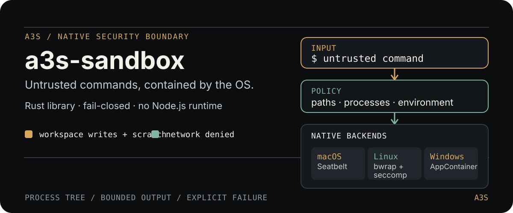

# A3S Sandbox

<p align="center">
  
</p>


<p align="center">
  <strong>Language / 语言:</strong>
  <a href="README.md">English</a> ·
  <a href="README.zh-CN.md">中文</a>
</p>

<p align="center">
  <a href="https://github.com/A3S-Lab/Sandbox/actions/workflows/ci.yml"></a>
  <a href="https://github.com/A3S-Lab/Sandbox/blob/main/LICENSE"></a>
  <a href="https://github.com/A3S-Lab/Sandbox/releases"></a>
</p>

`a3s-sandbox` is a Rust-native, fail-closed command boundary for A3S Bash and
other A3S products. It turns an untrusted command into a bounded process tree
with explicit workspace, credential, environment, network, and lifecycle
limits enforced by the host operating system.

There is no Node.js runtime, npm package, or SRT process in the execution
path. The library is deliberately independent of A3S Code so it can be
embedded by a CLI, an agent, or a future SDK.

## Quick start

Add the published crate from crates.io. Crate versions are immutable; update
the version intentionally when adopting a newer release:

```toml
[dependencies]
a3s-sandbox = "0.3.0"
```

Run a command through the native boundary:

```rust,no_run
use a3s_sandbox::NativeSandbox;

#[tokio::main]
async fn main() -> anyhow::Result<()> {
    let workspace = std::env::current_dir()?;
    let sandbox = NativeSandbox::new(workspace)?;

    let report = sandbox.probe().await?;
    report.require_lifetime_containment()?;

    let output = sandbox.exec_command("echo inside sandbox").await?;
    println!("{}", output.stdout);
    Ok(())
}
```

`CommandOutput` contains separate `stdout` and `stderr`, an exit code, and a
`timed_out` flag. Captured output is bounded to 100 KiB, while an optional
`OutputObserver` can receive live deltas and final accounting.

## What is enforced now

The default A3S Bash profile is intentionally strict:

- network access and host Unix-domain sockets are denied;
- writes are limited to the canonical workspace and a private scratch
  directory;
- credentials, secret files, `.git`, `.a3s`, agent metadata, and shell/tool
  bootstrap files are protected;
- symbolic-link escapes and source-tree hard-link aliases are rejected;
  package/build-store hardlinks stay usable unless they alias a discovered
  credential inode;
- child environments are sanitized, temporary state is redirected, and shell
  injection variables are removed;
- host-held secret environment entries are delivered only as redacted
  sentinels and refuse to run without an active mediation boundary;
- deadlines terminate the original process group on macOS and the native
  isolation boundary on Linux/Windows; output capture stays bounded;
- a missing launcher, unavailable namespace, or failed capability probe returns
  an error instead of executing on the host.

macOS descendants can escape the original process group with `setsid` or
`setpgid`. The Seatbelt backend does not guarantee complete descendant cleanup
or cleanup after the host exits. `probe()` proves launcher availability, not
lifetime containment. Hosts requiring that guarantee must use a qualified
execution backend; a successful probe must not waive that requirement.

`capability_report()` describes compiled capabilities without starting a
command (`runtime_probed=false`). `probe()` returns a report after a real
launcher check (`runtime_probed=true`). `require_lifetime_containment()`
returns a typed `ExecutionUnavailable` reason when the probe or either
lifetime guarantee is missing. Windows host-exit admission remains unavailable while S4 qualification,
including cross-host ACL recovery, is incomplete.
Read the [security model](SECURITY.md) and [threat model](THREAT_MODEL.md) for
platform claims, residuals, exact protected paths, and the Gate 7 review
checklist. Generate a CycloneDX SBOM with:

```bash
./scripts/generate-sbom.sh sbom.cdx.json
```

## Native boundaries

| Host | Boundary | Host requirement |
| --- | --- | --- |
| macOS | Seatbelt profile plus original process-group cleanup; detached lifetime unqualified | System `/usr/bin/sandbox-exec` |
| Linux | Bubblewrap user/mount/PID/IPC/UTS namespaces plus seccomp | `/usr/bin/bwrap` and an unprivileged user namespace |
| Windows | PowerShell 7 inside an AppContainer, restricted workspace ACLs, temporary drive, and kill-on-close Job Object | Windows 10 / Server 2016 or newer; PowerShell 7 under system Program Files |
| Other targets | Explicit unsupported-platform error | No host fallback |

The backend is selected at compile time, while policy construction and command
output stay platform-neutral. Same-workspace Windows executions serialize
inside one host. Each sandbox has an independent AppContainer identity, and
cleanup removes only that identity’s temporary ACL entries. Cross-host
coordination and recovery after a host crash remain unqualified.

## Execution model

```text
CommandRequest
    │
    ├── canonical workspace + private scratch directory
    ├── sanitized environment + protected path set
    └── native backend
          ├── macOS  → Seatbelt
          ├── Linux  → Bubblewrap + seccomp
          └── Windows → AppContainer + Job Object
                    │
                    └── bounded CommandOutput + observer events
```

The policy layer is the single source of truth. Platform modules enforce its
decisions; they do not silently broaden them when a host feature is missing.

## Scope and roadmap

Gate 0's filesystem, environment, and network controls are shipped and tested
on macOS, Linux, and Windows. Complete macOS native descendant containment is
not qualified. Later gates follow a first-principles order: typed policy, then
structured denials and OS resource quotas, then deeper filesystem mounts,
then opt-in mediated HTTP(S), then broader IPC/SOCKS, then CLI/adapters, then
security release. Virtual bash and in-process language VMs are non-goals.

See [ROADMAP.md](ROADMAP.md) for mission, non-goals, ranked capabilities,
exit criteria, architecture, and risks.

The goal is OS-enforced security outcomes for A3S products with a Rust-owned
API—not an SRT TypeScript clone and not a simulated shell.

## Development

Install the platform prerequisites, then run the same gates used by CI:

```bash
cargo fmt --all -- --check
cargo clippy --all-targets -- -D warnings
cargo test --all-targets
```

`a3s-sandbox-relay` is the guest TCP→Unix CONNECT helper used by the Linux
netns mediation bridge. It is built alongside `a3s-sandbox`. Place it next to
the host executable or set `A3S_SANDBOX_RELAY`. macOS, Linux, and Windows claim
`mediated_http` after live guest proof; SOCKS is available on macOS and Linux.

Release packaging helpers:

```bash
./scripts/generate-sbom.sh
./scripts/sign-release.sh target/release/a3s-sandbox target/release/a3s-sandbox-relay
```

See [docs/RELEASE_CHECKLIST.md](docs/RELEASE_CHECKLIST.md),
[docs/INDEPENDENT_REVIEW.md](docs/INDEPENDENT_REVIEW.md),
[docs/WINDOWS_WSL_GA.md](docs/WINDOWS_WSL_GA.md), and
[docs/GA_STATUS.md](docs/GA_STATUS.md) for the production release gate
(including Windows host + WSL2 native-FS evidence). Collect local evidence
with:

```bash
./scripts/collect-release-evidence.sh
# WSL2 (native Linux FS only — refuse /mnt/<drive>):
./scripts/run-wsl-ga-tests.sh
```

The CI matrix covers `ubuntu-latest`, `macos-14`, and `windows-latest`.
Security-sensitive changes should include a negative test proving that a
denied operation cannot reach the host through a descendant, inherited handle,
environment variable, symlink, hard link, socket, or alternate network path.

## License

MIT
